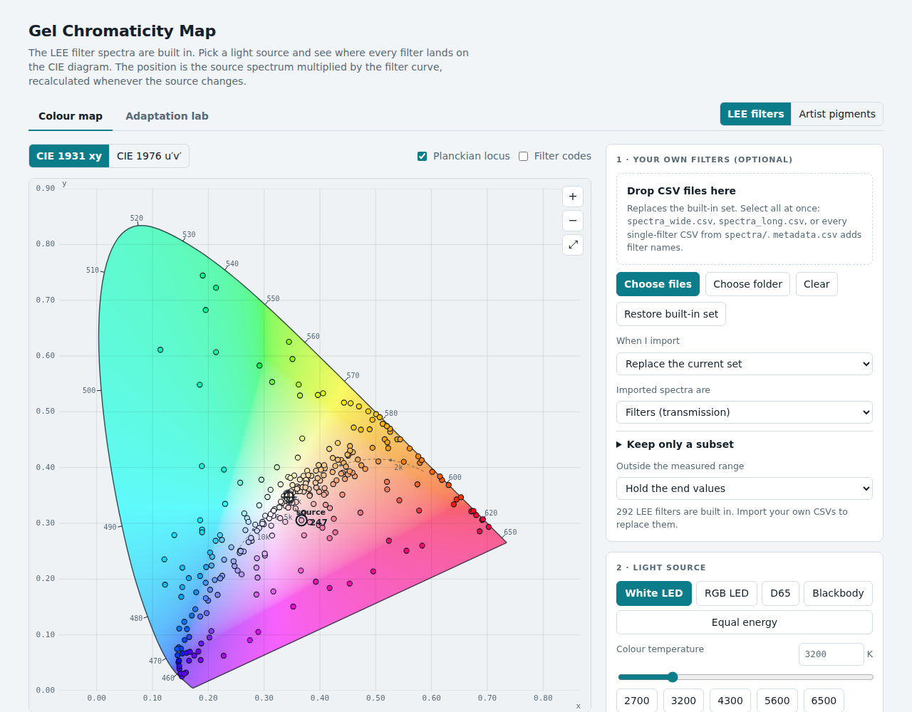
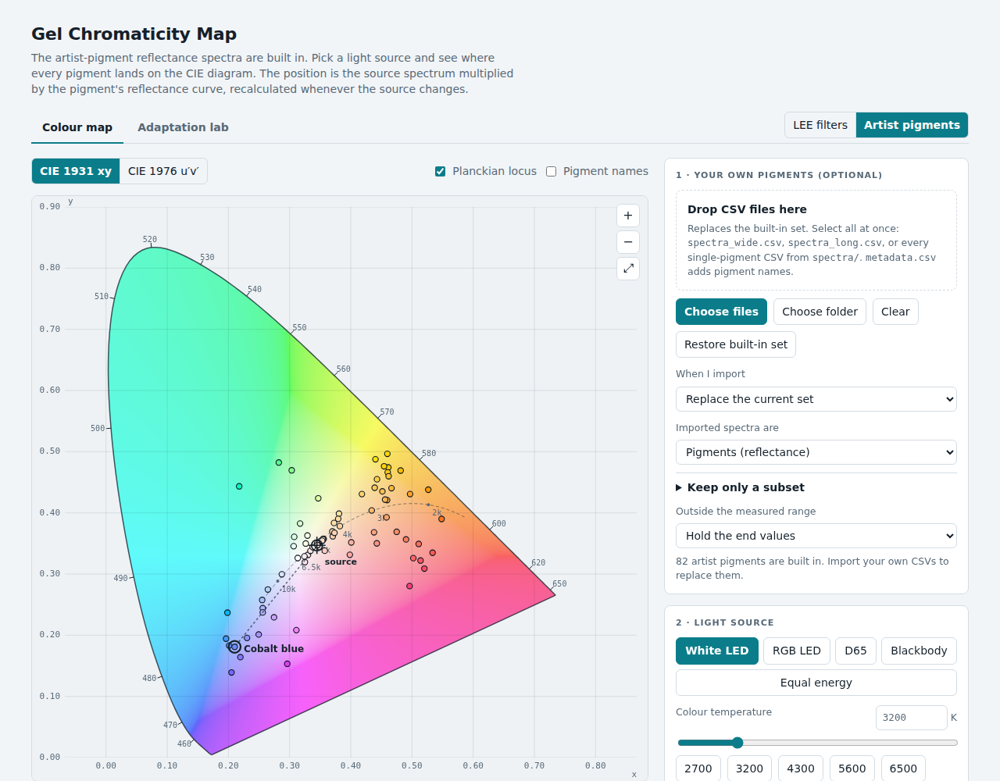
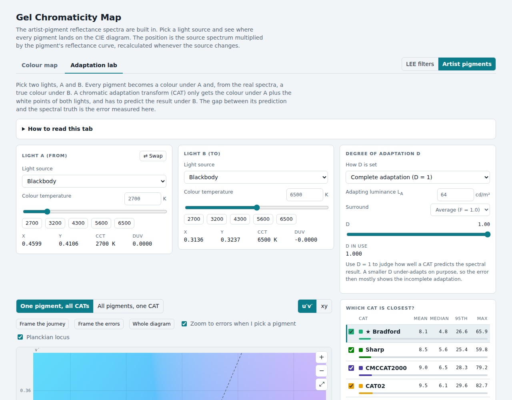

# Gel Chromaticity Map

An interactive, single-file web tool that shows where **lighting filters (gels)** and **artist pigments** land on the CIE chromaticity diagram under a light source you choose, and lets you compare **chromatic adaptation transforms (CATs)** against the spectrally exact answer.

It is one HTML file with no server and no dependencies. The spectra of 292 LEE filters and 82 artist pigments are built in, and you can load your own.



## What it does

- **Colour map.** Every filter or pigment becomes a point on the CIE 1931 xy or CIE 1976 u′v′ diagram. The point is calculated from the real spectrum: light source × filter transmission (or pigment reflectance) × the CIE 1931 2° observer. Change the source (white LED, RGB LED, D65, a blackbody at any temperature, equal energy, or your own LED spectrum) and every point moves. The detail panel shows the spectra, x y u′ v′, CCT, Duv and the shift from the bare source.
- **Adaptation lab.** Pick light A and light B. A CAT sees only the colour under A and the two white points, and predicts the colour under B. The lab compares seven CATs (XYZ scaling, von Kries, Bradford, CAT02, CAT16, Sharp, CMCCAT2000) with the true colour calculated from the spectra, so you can see which CAT is best and which filters it gets most wrong. Incomplete adaptation (degree D) is supported.
- **Your own data.** Drop CSV files on the page. Replace the built-in set or add to it, and keep only a subset (by pasting a list of names or numbers).
- **Plug-in metrics.** New measures such as CRI or TM-30 can be added as one small file. See [docs/ARCHITECTURE.md](docs/ARCHITECTURE.md).

| Artist pigments | Adaptation lab |
|---|---|
|  |  |

## Quick start

**Just use it.** Open `dist/index.html` in a browser (double-click it). Nothing is uploaded anywhere; all calculation happens in your browser.

**Build it yourself** (Python 3 only, no packages):

```bash
python3 tools/build.py          # writes dist/index.html
python3 tools/build.py --check  # syntax-check the bundled JavaScript (needs node)
```

**Run the tests:**

```bash
node tests/maths.mjs                                   # colour maths, no browser
pip install playwright && playwright install chromium
python3 tests/smoke.py                                 # drives the page in headless Chromium
```

## Using your own spectra

Open section 1 of the colour map and drop CSV files on it. The simplest file has two columns, wavelength in nm and the transmission or reflectance (a fraction 0–1, or percent):

```csv
wavelength_nm,transmission
400,0.02
410,0.03
...
```

You can also load many at once (wide table, or long table with a `filter_id` column), add names with a metadata file, replace or add to the current set, and keep only a subset. Full details, with example files in [`examples/`](examples/): **[docs/DATA_FORMATS.md](docs/DATA_FORMATS.md)** and **[docs/USER_GUIDE.md](docs/USER_GUIDE.md)**.

## Project layout

```
src/
  index.html            page template
  partials/             HTML for the header, the colour map tab, the lab tab
  css/                  base.css, lab.css
  js/
    manifest.txt        build order of every module (add a line to add a module)
    core/               colour science, no DOM: CMF, locus, CCT/Duv, resampling, example sources
    metrics/            metric plug-ins (registry + examples)
    app/                colour map tab: data sets, import, subset, list, diagram, interaction
    lab/                adaptation lab tab: CAT matrices, computation, diagram, panels
    boot.js             start-up
data/                   lee.json, pigments.json (built-in spectra)
tools/                  build.py, lee_scraper.py, converters from CSV/text folders to data/*.json
tests/                  maths.mjs (node), smoke.py (browser)
examples/               sample CSVs and a subset list
docs/                   user guide, data formats, architecture, maths, publishing
dist/index.html         the built single file
```

## Documentation

| | |
|---|---|
| [docs/USER_GUIDE.md](docs/USER_GUIDE.md) | How to use both tabs, what the numbers mean, limits |
| [docs/DATA_FORMATS.md](docs/DATA_FORMATS.md) | CSV formats the page accepts, subset lists, building `data/*.json` |
| [docs/ARCHITECTURE.md](docs/ARCHITECTURE.md) | How the code fits together; add a data set, a metric (CRI, TM-30), a CAT |
| [docs/MATHS.md](docs/MATHS.md) | The calculations and their assumptions |
| [docs/PUBLISHING.md](docs/PUBLISHING.md) | Put the repository on GitHub and host the page with GitHub Pages |

## Limits worth knowing

- Colours are **relative to a perfect transmitter or diffuser** under the chosen light. Brightness is reported as a number but the dots on the diagram show chromaticity only.
- Frosts and diffusion filters scatter light; a transmission curve alone does not describe them fully.
- Only the **adaptation step** of CIECAM02 and CAM16 (CAT02 and CAT16) is implemented, not the full appearance models.
- The pigment spectra were measured on painted cardboard in an acrylic binder; gloss, texture and the support are not modelled.

## Data and licensing

The **code** is under the MIT licence ([LICENSE](LICENSE)). The **built-in spectra are not covered by that licence**; see [NOTICE.md](NOTICE.md) before redistributing them.

## Contributing

Issues and pull requests are welcome. Please run both test scripts first, and rebuild `dist/index.html`.
# gel-chromaticity-map
