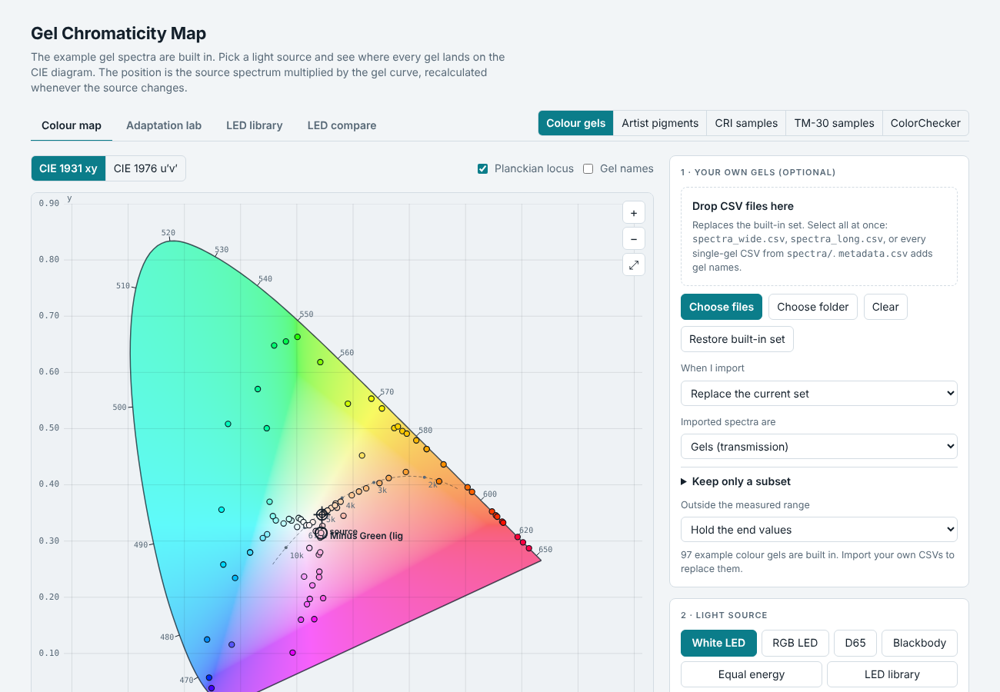
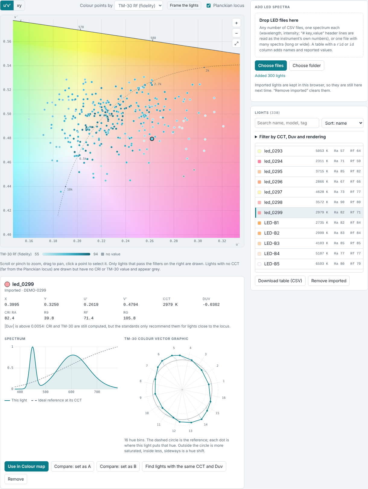
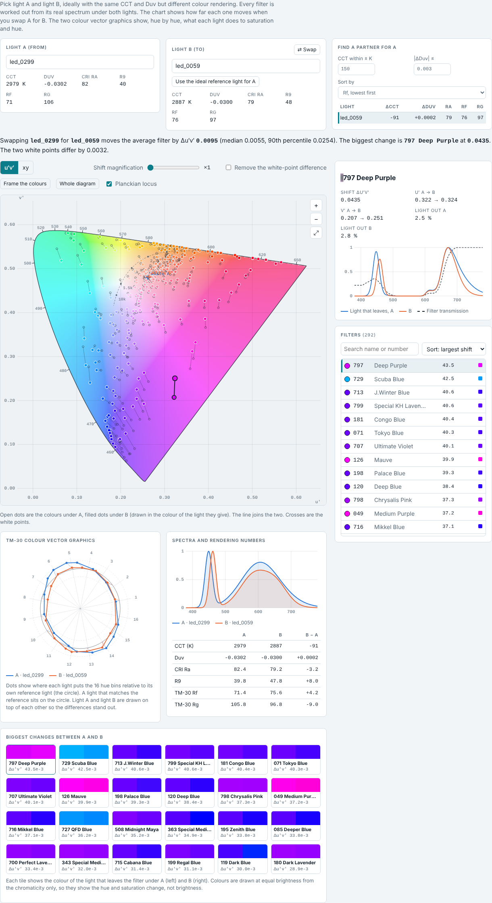

# Gel Chromaticity Map

An interactive, single-file web tool that shows where **lighting filters (gels)** and **artist pigments** land on the CIE chromaticity diagram under a light source you choose, and lets you compare **chromatic adaptation transforms (CATs)** against the spectrally exact answer.

It is one HTML file with no server and no dependencies. Built in: 97 synthetic example colour gels, 82 artist pigments, and three open reflectance sets (the 14 CRI test colour samples, the 99 TM-30 colour evaluation samples and the 24 ColorChecker patches). Real filter catalogues such as LEE, and sets such as Munsell, are not bundled: load your own files (see `docs/IMPORTING.md`). Imported data is saved in your browser, so you only load it once.



## What it does

- **Colour map.** Every filter or pigment becomes a point on the CIE 1931 xy or CIE 1976 u′v′ diagram. The point is calculated from the real spectrum: light source × filter transmission (or pigment reflectance) × the CIE 1931 2° observer. Change the source (white LED, RGB LED, D65, a blackbody at any temperature, equal energy, or your own LED spectrum) and every point moves. The detail panel shows the spectra, x y u′ v′, CCT, Duv and the shift from the bare source.
- **Adaptation lab.** Pick light A and light B. A CAT sees only the colour under A and the two white points, and predicts the colour under B. The lab compares seven CATs (XYZ scaling, von Kries, Bradford, CAT02, CAT16, Sharp, CMCCAT2000) with the true colour calculated from the spectra, so you can see which CAT is best and which filters it gets most wrong. Incomplete adaptation (degree D) is supported.
- **LED library.** Import hundreds or thousands of LED spectra (instrument exports, many-in-one tables, metadata tables) next to 38 built-in CIE sources. CRI (Ra, R1–R14) and TM-30 (Rf, Rg, per-hue shifts) are calculated for each, validated against `colour-science`. Plot them all on the CIE diagram, filter by CCT, Duv and rendering, and pick one as the light source anywhere in the app.
- **LED compare.** Choose LED A and a partner B with the same CCT and Duv but different CRI or TM-30, and see how every filter or pigment shifts, with TM-30 colour vector graphics for both lights. You can rank and colour by colour shift, brightness change, a combined apparent change ΔE (CIELUV or CAM02-UCS, with a 3D view), (equal lumens or equal watts) or absorbed energy, and choose how the white-point difference is removed (CRI, TM-30/CIECAM02 or any matrix CAT).
- **Your own data.** Drop CSV files on the page. Replace the built-in set or add to it, and keep only a subset (by pasting a list of names or numbers).
- **Plug-in metrics.** CRI and TM-30 are plug-ins; new measures can be added as one small file. See [docs/ARCHITECTURE.md](docs/ARCHITECTURE.md).

| Artist pigments | Adaptation lab |
|---|---|
|  |  |

| LED library | LED compare |
|---|---|
|  |  |

## Quick start

**Just use it.** Open `dist/index.html` in a browser (double-click it). Nothing is uploaded anywhere; all calculation happens in your browser.

**Host it and use it like an app.** Push the repository to GitHub, turn on GitHub Pages, and open the address on any device; it can then be installed to the home screen or desktop and works offline. Steps in [docs/PUBLISHING.md](docs/PUBLISHING.md).

**Build it yourself** (Python 3 only, no packages):

```bash
python3 tools/build.py          # writes dist/index.html
python3 tools/build.py --check  # syntax-check the bundled JavaScript (needs node)
```

**Run the tests:**

```bash
node tests/maths.mjs                                   # colour maths, no browser
pip install playwright && playwright install chromium
python3 tests/smoke.py                                 # drives the page in headless Chromium
python3 tests/pwa.py                                   # install / offline behaviour over http
```

## Using your own spectra

Open section 1 of the colour map and drop CSV files on it. The simplest file has two columns, wavelength in nm and the transmission or reflectance (a fraction 0–1, or percent):

```csv
wavelength_nm,transmission
400,0.02
410,0.03
...
```

You can also load many at once (wide table, or long table with a `filter_id` column), add names with a metadata file, replace or add to the current set, and keep only a subset. Full details, with example files in [`examples/`](examples/): **[docs/IMPORTING.md](docs/IMPORTING.md)** (start here), [docs/DATA_FORMATS.md](docs/DATA_FORMATS.md)** and **[docs/USER_GUIDE.md](docs/USER_GUIDE.md)**.

## Project layout

```
src/
  index.html            page template
  partials/             HTML for the header, the colour map tab, the lab tab
  css/                  base.css, lab.css
  js/
    manifest.txt        build order of every module (add a line to add a module)
    core/               colour science, no DOM: CMF, locus, CCT/Duv, CRI, TM-30, resampling, example sources
    metrics/            metric plug-ins (registry + examples)
    app/                colour map tab: data sets, import, subset, list, diagram, interaction
    lab/                adaptation lab tab: CAT matrices, computation, diagram, panels
    led/                LED library: file parsing, store, chooser, the LED library and LED compare tabs
    boot.js             start-up
  pwa/                  web-app manifest, service worker, icons
data/                   gels.json, pigments.json, colorchecker.json, standard-sources.json, colour-tables.json (lee.json: optional, yours, git-ignored)
tools/                  build.py, make_example_gels.py, lee_scraper.py, spectra_matrix_to_csv.py, converters from CSV/text folders to data/*.json
tests/                  maths.mjs (node, incl. CRI/TM-30 vs colour-science), smoke.py, leds.py, pwa.py (browser)
examples/               sample CSVs and a subset list
docs/                   user guide, data formats, architecture, maths, publishing
dist/                   the built page (index.html) plus manifest, icons and service worker
```

## Documentation

| | |
|---|---|
| [docs/USER_GUIDE.md](docs/USER_GUIDE.md) | How to use all four tabs (map, lab, LED library, LED compare), what the numbers mean, limits |
| [docs/IMPORTING.md](docs/IMPORTING.md) | **How to add your own filters, pigments and LEDs**: file layouts, templates, saving, backup |
| [docs/DATA_FORMATS.md](docs/DATA_FORMATS.md) | CSV formats the page accepts, subset lists, building `data/*.json` |
| [docs/ARCHITECTURE.md](docs/ARCHITECTURE.md) | How the code fits together; add a data set, a metric (CRI, TM-30), a CAT |
| [docs/MATHS.md](docs/MATHS.md) | The calculations and their assumptions |
| [docs/PUBLISHING.md](docs/PUBLISHING.md) | Put the repository on GitHub and host the page with GitHub Pages |

## Limits worth knowing

- Colours are **relative to a perfect transmitter or diffuser** under the chosen light. Brightness is reported as a number but the dots on the diagram show chromaticity only.
- Frosts and diffusion filters scatter light; a transmission curve alone does not describe them fully.
- CRI and TM-30 are validated against `colour-science` (see docs/MATHS.md) but are unreliable below about 1700 K and for lights far from the Planckian locus.
- Only the **adaptation step** of CIECAM02 and CAM16 (CAT02 and CAT16) is implemented, not the full appearance models.
- The pigment spectra were measured on painted cardboard in an acrylic binder; gloss, texture and the support are not modelled.

## Data and licensing

The **code** is under the MIT licence ([LICENSE](LICENSE)). The **built-in spectra are not covered by that licence**; see [NOTICE.md](NOTICE.md) before redistributing them.

## Contributing

Issues and pull requests are welcome. Please run both test scripts first, and rebuild `dist/index.html`.
